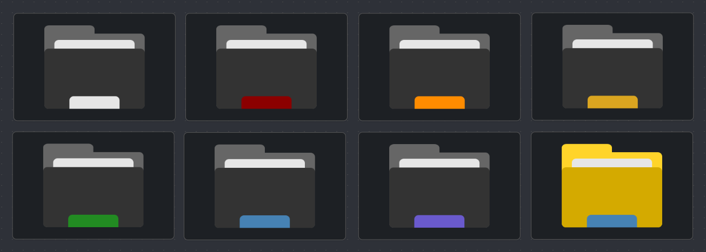

<h2 align="center">Hello there, 👋 my name is Yan Verrept.</h2>

<h3>😄 Who am I?:</h3>

I am an university student in an IT major who also is an IT enthousiast, I am regularly trying to explore the IT world to see what it has to offer.

Currently I am exploring programming and linux more, but I also like doing small graphic design for personal use.

---

    

        <strong> 👀Example of my Graphic designs</strong>
    

    <h4>Custom folder icons:</h4>
    

        
        
    

---

<h3>🌱 Programming languages I know:</h3>

Keep in mind that my experience and skills with those programming languages may differ from beginner to intermediate in the context of university. 

<h4>General purpose languages:</h4>

-   C# and dotnet framework
-   Python (basics)

<h4>Web based languages:</h4>

-   Html
-   Css (including bootstrap)
-   Javascript (basics)

<h4>Database languages:</h4>

-   Mysql and Postgress (neondb)
-   MongoDB 

---
 
<h3>📫 Links:</h3>
-  [LinkedIn](www.linkedin.com/in/yan-verrept)

<!---
- 👋 Hi, I’m @verrepty1223
- 👀 I’m interested in learning about programming and IT in general
- 🌱 I’m currently learning ❓
- 🧠 I'm know python (basic), csharp, mysql, html, css, asp.net
- 💞️ I’m looking to collaborate on /
- 📫 How to reach me /
- 😄 Pronouns: he/him
- ⚡ Fun fact: / --->

<!---
verrepty1223/verrepty1223 is a ✨ special ✨ repository because its `README.md` (this file) appears on your GitHub profile.
You can click the Preview link to take a look at your changes.
--->
